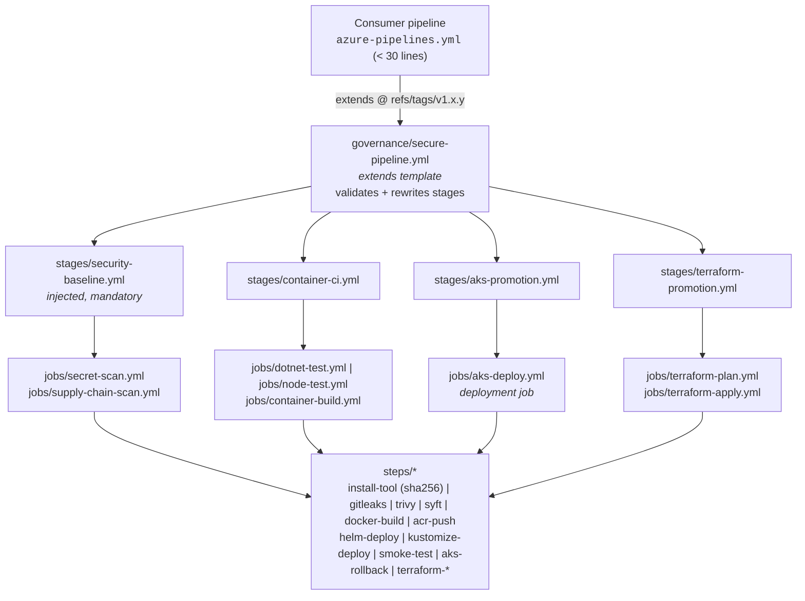

# Azure DevOps Pipeline Templates

[](https://github.com/rsk071216-stack/azure-devops-pipeline-templates/actions/workflows/ci.yml)
[](CHANGELOG.md)
[](LICENSE)


**An enterprise Azure Pipelines template library that a platform team publishes
once and every application team consumes in under 30 lines of YAML - with security
scanning, secretless Azure access, approvals and automatic rollback enforced by
the platform, not by good intentions.**

```yaml
extends:
  template: templates/governance/secure-pipeline.yml@templates   # mandatory, enforced by Azure DevOps checks
  parameters:
    stages:
      - template: templates/stages/container-ci.yml@templates     # test -> build -> Trivy -> SBOM -> push by digest
        parameters: { testStack: dotnet, azureServiceConnection: sc-shop-build, acrName: acrshopprod, repository: shop/web }
      - template: templates/stages/aks-promotion.yml@templates    # dev -> test -> prod with gates + rollback
        parameters:
          appName: shop-web
          environments:
            - { name: dev,  serviceConnection: sc-shop-dev,  resourceGroup: rg-shop-dev,  cluster: aks-shop-dev }
            - { name: test, serviceConnection: sc-shop-test, resourceGroup: rg-shop-test, cluster: aks-shop-test, promoteFrom: dev }
            - { name: prod, serviceConnection: sc-shop-prod, resourceGroup: rg-shop-prod, cluster: aks-shop-prod, promoteFrom: test }
```

> **Honest scope note.** Azure Pipelines YAML only executes inside an Azure
> DevOps organisation. This repository's CI (GitHub Actions) validates
> everything that can be validated without one - YAML, the template contract,
> documentation coverage, version pinning, the official pipeline JSON schema
> for root pipelines, the GitHub workflows and the Terraform governance module.
> Compiling and running the templates requires an Azure DevOps project; see
> [ADR 0004](docs/adr/0004-static-validation-strategy.md).

---

## Contents

- [The problem this solves](#the-problem-this-solves)
- [Architecture](#architecture)
- [Features](#features)
- [What makes this different](#what-makes-this-different)
- [Before and after](#before-and-after)
- [Quick start for a consuming team](#quick-start-for-a-consuming-team)
- [Versioning and release policy](#versioning-and-release-policy)
- [Governance enforcement](#governance-enforcement)
- [Security](#security)
- [Design decisions](#design-decisions)
- [Repository layout](#repository-layout)
- [How I can apply this to your organisation](#how-i-can-apply-this-to-your-organisation)
- [Roadmap](#roadmap)

## The problem this solves

Most Azure DevOps estates I meet look the same after a few years:

- **Copy-pasted YAML across 50+ repositories.** Every team forked a pipeline
  from another team two years ago. A fix to the Docker build or a new scanner
  has to be applied 50 times - so it never is.
- **Inconsistent security.** Some pipelines scan images, most do not. Secret
  scanning is "on the roadmap". Nobody can prove which build produced what is
  running in production.
- **Secrets in service connections.** Service principals with client secrets
  that expire on a Friday night, get copied into variable groups, and outlive
  the engineers who created them.
- **Approvals that can be bypassed.** A pipeline author can add
  `condition: always()` or an inline `az` script and reach production with the
  same credentials as the release pipeline.
- **Slow onboarding.** A new service needs a week of pipeline work and a review
  from the one person who understands the release process.

This library turns the pipeline into a **product owned by the platform team**:
versioned, documented, tested, and enforced through Azure DevOps' own controls.

## Architecture

### Template hierarchy



### Promotion flow with gates

```mermaid
flowchart LR
    PR([Pull request]) --> SB1[SecurityBaseline] --> B1[Build: test, scan, SBOM<br/>no push, no deploy]

    M([Merge to main]) --> SB[SecurityBaseline<br/>gitleaks | SBOM | Trivy fs]
    SB --> B[Build<br/>tests + coverage gate<br/>image scan gate<br/>push by digest]
    B --> D[Deploy dev<br/>auto]
    D --> T{{"test environment checks<br/>approval | required template"}}
    T --> DT[Deploy test]
    DT --> P{{"prod environment checks<br/>2 approvers | business hours<br/>exclusive lock | required template"}}
    P --> DP[Deploy prod<br/>Helm --rollback-on-failure]
    DP --> SM[Smoke test]
    SM -- fail --> RB[Automatic rollback<br/>guarded by digest]
    SM -- pass --> OK([Tag run: deployed-prod])
```

Terraform follows the same shape with `Plan_<env>` (runs on every PR with a
Reader identity) and `Apply_<env>` (runs only when the plan has changes, after
approval of the published plan).

## Features

| Area | What you get | Where |
|---|---|---|
| Governance | `extends` template that injects a mandatory security stage and rejects inline scripts, shell tasks, raw deployment jobs, foreign templates and persisted credentials at compile time | [`templates/governance`](templates/governance/secure-pipeline.yml) |
| Secretless auth | Workload Identity Federation for ACR, AKS (kubelogin) and Terraform (provider + Entra ID state backend) | [docs](docs/workload-identity-federation.md) |
| Container CI | BuildKit build with OCI labels, Trivy gate **before** push, SPDX + CycloneDX SBOM, push by digest | [`jobs/container-build.yml`](templates/jobs/container-build.yml) |
| Tests | .NET (coverlet) and Node (JUnit + Cobertura) with published results and a real coverage gate | [`jobs/dotnet-test.yml`](templates/jobs/dotnet-test.yml), [`jobs/node-test.yml`](templates/jobs/node-test.yml) |
| AKS delivery | Helm 4 (`--rollback-on-failure`) or Kustomize (server-side apply), digest-pinned, smoke test, guarded automatic rollback | [`jobs/aks-deploy.yml`](templates/jobs/aks-deploy.yml) |
| Terraform | fmt/validate/IaC scan, plan artifact + Plan tab + Markdown summary highlighting destroys, apply of the exact reviewed plan in a deployment job | [`stages/terraform-promotion.yml`](templates/stages/terraform-promotion.yml) |
| Promotion | Any number of environments, order via `promoteFrom` (fan-out supported), deploy branch only, never from PRs | [`stages/aks-promotion.yml`](templates/stages/aks-promotion.yml) |
| Supply chain | Every tool pinned **and** SHA-256 verified; tasks pinned to major versions; GitHub Actions pinned by commit SHA | [`steps/install-tool.yml`](templates/steps/install-tool.yml) |
| Governance as code | Terraform for environments, approvals, business hours, exclusive lock, Required template, branch control, WIF service connections, managed identities, RBAC | [`platform/azure-devops-governance`](platform/azure-devops-governance) |
| Audit trail | Runs tagged `governed`, `template-library-vX.Y.Z`, `security-profile-*`, `deployed-<env>`, `rolled-back` | [`stages/security-baseline.yml`](templates/stages/security-baseline.yml) |
| Docs | Catalogue of every template and parameter (CI-enforced), onboarding, governance model, migration from classic releases, ADRs | [`docs/`](docs) |

## What makes this different

- **Enforced, not recommended.** The `extends` template is paired with the
  *Required template* check on environments **and** service connections. A
  pipeline that does not use it cannot obtain an Azure token or deploy.
- **Bypass-resistant by design.** `dependsOn: []` and `condition: always()` are
  rewritten so the security baseline still gates the stage; raw deployment jobs
  are rejected. See the [negative example](examples/policy-violation/azure-pipelines.yml).
- **The allow-list of tags is the support policy.** Removing a tag from the
  Required template check retires that version for protected resources - a
  security fix becomes mandatory without touching consumer repositories.
- **Approvers approve what they can see.** Terraform plan and apply are
  separate stages because checks are evaluated at stage start; the plan summary
  is on the run before anyone is asked to approve.
- **Rollback that will not hurt you.** The `on.failure` hook only rolls back if
  the live release runs the digest from this run and Helm has not already
  restored it - no "rollback of a healthy release" after an unrelated failure.
- **Documentation that cannot rot.** CI fails if a parameter is added, removed
  or renamed without updating the catalogue.

## Before and after

<details>
<summary><b>Before</b> - a typical hand-written pipeline (excerpt of ~220 lines, repeated with variations in every repository)</summary>

```yaml
trigger: [main]
variables:
  - group: shop-secrets                      # client secret + ACR password live here
stages:
  - stage: Build
    jobs:
      - job: Build
        pool: { vmImage: ubuntu-latest }     # floating image
        steps:
          - task: UseDotNet@2
            inputs: { version: 8.x }
          - script: dotnet test --collect "XPlat Code Coverage"
          - task: PublishCodeCoverageResults@1
            inputs: { codeCoverageTool: Cobertura, summaryFileLocation: '**/coverage.cobertura.xml' }
          - script: |
              echo $(ACR_PASSWORD) | docker login acrshop.azurecr.io -u acrshop --password-stdin
              docker build -t acrshop.azurecr.io/shop/web:latest .
              docker push acrshop.azurecr.io/shop/web:latest          # pushed before any scan
  - stage: DeployDev
    jobs:
      - deployment: Deploy
        environment: dev
        strategy:
          runOnce:
            deploy:
              steps:
                - script: |
                    az login --service-principal -u $(SP_ID) -p $(SP_SECRET) --tenant $(TENANT)
                    az aks get-credentials -g rg-shop-dev -n aks-shop-dev --admin
                    helm upgrade --install shop ./chart --set image.tag=latest
  # ...the same 60 lines again for test and prod, slightly different each time,
  # no secret scan, no SBOM, no smoke test, no rollback, approvals configured by hand
```
</details>

**After** - [`examples/aks-web-app/azure-pipelines.yml`](examples/aks-web-app/azure-pipelines.yml), 28 lines including triggers and the template reference:

```yaml
trigger:
  branches:
    include: [main]
pr:
  branches:
    include: [main]

resources:
  repositories:
    - repository: templates
      type: github
      name: rsk071216-stack/azure-devops-pipeline-templates
      ref: refs/tags/v1.0.0
      endpoint: github-platform-templates

extends:
  template: templates/governance/secure-pipeline.yml@templates
  parameters:
    stages:
      - template: templates/stages/container-ci.yml@templates
        parameters: { testStack: dotnet, azureServiceConnection: sc-shop-build, acrName: acrshopprod, repository: shop/web }
      - template: templates/stages/aks-promotion.yml@templates
        parameters:
          appName: shop-web
          helmValuesDirectory: deploy/helm
          environments:
            - { name: dev, serviceConnection: sc-shop-dev, resourceGroup: rg-shop-dev, cluster: aks-shop-dev }
            - { name: test, serviceConnection: sc-shop-test, resourceGroup: rg-shop-test, cluster: aks-shop-test, promoteFrom: dev }
            - { name: prod, serviceConnection: sc-shop-prod, resourceGroup: rg-shop-prod, cluster: aks-shop-prod, promoteFrom: test,
                smokeTestUrl: 'https://shop.example.com/healthz' }
```

| | Before | After |
|---|---|---|
| Lines per repository | ~220 | 28 |
| Secrets | SP secret + ACR password in variable group | none (WIF) |
| Image scanning | none | Trivy gate before push |
| Secret scanning / SBOM | none | every run, mandatory |
| What is deployed | `:latest` | one immutable digest, all environments |
| Prod gates | hand-configured, bypassable | Terraform-managed checks, Required template |
| Rollback | manual | automatic, guarded |
| Updating 50 repos | 50 PRs, drift | bump one tag |

## Quick start for a consuming team

1. Ask the platform team for: environments + WIF service connections
   (`platform/azure-devops-governance`), a GitHub service connection to this
   repository, and an AKS namespace.
2. Make your Helm chart render `image: "{{ .Values.image.repository }}@{{ .Values.image.digest }}"`.
3. Copy [`examples/aks-web-app/azure-pipelines.yml`](examples/aks-web-app/azure-pipelines.yml)
   (or [`examples/terraform-infra`](examples/terraform-infra/azure-pipelines.yml)) and change the names.
4. Create the pipeline in Azure DevOps and authorise the template repository,
   environments and service connections on the first run.
5. Open a PR: security baseline + build run, nothing deploys. Merge: dev deploys,
   test and prod wait for their checks.

Full guide: [docs/onboarding.md](docs/onboarding.md) | Parameters:
[docs/catalogue.md](docs/catalogue.md).

## Versioning and release policy

- Consumers pin `ref: refs/tags/vMAJOR.MINOR.PATCH` - never a branch.
- [Semantic Versioning for templates](docs/release-process.md#what-counts-as-a-breaking-change):
  removed/renamed parameters, changed defaults and **new mandatory policy rules**
  are MAJOR.
- Every release updates [CHANGELOG.md](CHANGELOG.md); CI enforces that the
  CHANGELOG version, the run tag, the examples and the Required template
  allow-list agree.
- Pushing a `vX.Y.Z` tag publishes a GitHub release with notes from the
  CHANGELOG ([release.yml](.github/workflows/release.yml)).
- Retiring a version = removing its tag from the Required template allow-list.

## Governance enforcement

1. **Publish** this repository in your organisation (Azure Repos or GitHub with
   a service connection) and restrict write access to the platform team
   (branch policies + CODEOWNERS).
2. **Apply** [`platform/azure-devops-governance`](platform/azure-devops-governance)
   per application: environments, approvals, business hours, exclusive lock,
   Required template and branch control checks, WIF service connections and RBAC.
3. **Lock down** project settings: only the platform team may create service
   connections, environments and repository resources; disable classic release
   pipelines for new projects; limit job authorisation scope to the project.
4. **Verify** with [`examples/policy-violation`](examples/policy-violation/azure-pipelines.yml):
   it must fail to compile with `POLICY VIOLATION` errors, and a pipeline that
   does not extend the template must be blocked by the Required template check.

Rules, rationale and known limits: [docs/governance-model.md](docs/governance-model.md).

## Security

| Control | Implementation |
|---|---|
| No long-lived credentials | Workload Identity Federation for every Azure call; Terraform state via Entra ID; AKS via kubelogin; no secret parameters anywhere |
| Least privilege | Separate plan (Reader) and apply identities; AcrPush only for build; AKS RBAC Writer scoped to one namespace |
| Mandatory scanning | gitleaks (full history, redacted, SARIF), syft SBOM (SPDX + CycloneDX), Trivy fs (dependencies + IaC), Trivy image gate before push, Trivy config before every Terraform plan |
| Pipeline integrity | Required template check; compile-time rejection of inline scripts and shell tasks; `persistCredentials` forbidden; template parameters passed to scripts via `env:` only (no script injection) |
| Supply chain of the pipeline itself | Tool binaries pinned and SHA-256 verified; tasks pinned to major versions; Actions pinned to commit SHAs; Dependabot for Actions and Terraform providers |
| Change control | Approvals (requester cannot approve), business hours, exclusive lock, branch control with verified branch protection |
| Immutability | Deploy by digest; reviewed Terraform plan applied as-is; annotated, never-moved release tags |

Found a vulnerability? Please open a private security advisory on GitHub rather
than a public issue.

## Design decisions

| ADR | Decision |
|---|---|
| [0001](docs/adr/0001-extends-template-as-governance-boundary.md) | `extends` template + Required template check is the governance boundary (not decorators, not opt-in includes) |
| [0002](docs/adr/0002-workload-identity-federation-only.md) | Workload Identity Federation only; no secrets |
| [0003](docs/adr/0003-semver-tags-for-template-consumption.md) | Immutable SemVer tags; the check allow-list is the support policy |
| [0004](docs/adr/0004-static-validation-strategy.md) | Contract lint for templates; JSON schema only for root pipelines (template expressions are not schema-representable) |
| [0005](docs/adr/0005-terraform-plan-apply-split.md) | Plan and apply in separate stages; infrastructure rolls forward |
| [0006](docs/adr/0006-digest-pinned-deploys-with-guarded-rollback.md) | Deploy by digest with guarded automatic rollback |

## Repository layout

```text
templates/
  governance/secure-pipeline.yml   extends template (mandatory)
  stages/                          security-baseline, container-ci, aks-promotion, terraform-promotion
  jobs/                            build, test, scan, terraform plan/apply, aks deploy
  steps/                           checksum-verified tools, scanners, deploy, rollback, summaries
examples/                          consumer pipelines (AKS app, Terraform, policy violation)
platform/azure-devops-governance/  Terraform: environments, checks, WIF connections, RBAC
docs/                              catalogue, onboarding, governance, WIF, migration, release process, ADRs
scripts/lint-templates.sh          template contract checks used by CI
tests/schema/                      negative fixture for the schema self-test
.github/workflows/                 CI (lint, schema, actionlint, terraform) and release
```

## How I can apply this to your organisation

I am a freelance Cloud DevOps engineer (9+ years, Azure and AWS). Typical
engagements built on this library:

- **Pipeline standardisation (2-4 weeks).** Inventory your existing pipelines,
  adapt the templates to your stack (Java/Python/Go, Web Apps, Functions,
  Container Apps, AKS), migrate the first 3-5 services and hand over a
  versioned library with docs and CI.
- **Secretless migration (1-2 weeks).** Convert every Azure service connection
  to Workload Identity Federation, remove client secrets and storage keys,
  introduce least-privilege identities per environment.
- **Governance rollout.** Required template checks, approvals, business hours
  and branch control as code; a policy that cannot be bypassed by pipeline
  authors, with a migration path that does not stop delivery.
- **Classic release migration.** Move classic release definitions to YAML
  environment by environment using the
  [migration guide](docs/migration-from-classic-releases.md).

Everything is delivered as code in your repositories, with ADRs explaining the
trade-offs, so your team owns it after I leave.

## Roadmap

- [ ] Image signing and verification (cosign / Notation with Azure Key Vault) and attestation of the SBOM
- [ ] Policy-as-code for Terraform plans (OPA/Conftest on `terraform show -json`)
- [ ] Canary and blue-green strategies for AKS (deployment job `canary` strategy + Gateway API traffic split)
- [ ] Scheduled compile test in a sandbox Azure DevOps project using `previewRun` for every example
- [ ] Templates for Azure Container Apps, App Service and Functions
- [ ] Java (Maven/Gradle) and Python test job templates
- [ ] Policy exceptions registry (time-boxed, approved waivers for specific rules)
- [ ] DORA metrics export from run tags

## License

[MIT](LICENSE) (c) 2026 Raees Khan
