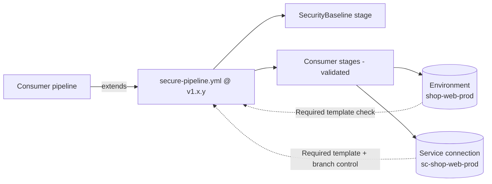

# Governance model

This page explains **how** the library enforces security and change-control
rules, **which** rules exist, and **where** the boundaries of that enforcement
are. It is written for platform engineers and security reviewers.

## Two layers of enforcement

| Layer | Mechanism | Who can bypass it |
|---|---|---|
| 1. Pipeline shape | `templates/governance/secure-pipeline.yml` (an `extends` template) validates and rewrites the consumer's stages at compile time | Nobody - **if** layer 2 forces its use |
| 2. Resource access | Azure DevOps checks on environments and service connections: **Required template**, approvals, business hours, exclusive lock, branch control | Only project administrators who can edit checks (managed by Terraform, so changes are reviewed) |

An `extends` template on its own is a convention: a team could write a pipeline
that does not extend it. The **Required template** check closes that gap: every
protected environment and service connection only accepts runs whose pipeline
extends `templates/governance/secure-pipeline.yml` from this repository at an
approved tag. A pipeline that does not use the template simply cannot deploy
or obtain an Azure token.



## Compile-time rules (secure-pipeline.yml)

| # | Rule | Why |
|---|---|---|
| G1 | A `SecurityBaseline` stage (gitleaks full history, syft SBOM, Trivy fs) is always injected first | Every change is scanned regardless of how the consumer pipeline looks |
| G2 | Consumer stages that declare `dependsOn` get `SecurityBaseline` prepended; stages without `dependsOn` inherit it through the implicit sequential chain | `dependsOn: []` cannot be used to run in parallel with, and therefore ignore, the baseline |
| G3 | A custom stage `condition` is rewritten to `and(succeeded('SecurityBaseline'), <condition>)`; a condition without an explicit `dependsOn` list is rejected | `condition: always()` cannot bypass a failed baseline |
| G4 | Stage, job and step templates must reference `@templates` | Consumers cannot smuggle steps in through their own templates |
| G5 | Raw `deployment` jobs are rejected | All deployments go through library jobs with digest pinning, smoke tests and rollback |
| G6 | `script`, `bash`, `powershell`, `pwsh` steps are rejected in consumer-authored jobs | Inline scripts are the most common path for unreviewed commands and secret exfiltration |
| G7 | `CmdLine@2`, `Bash@3`, `PowerShell@2`, `ShellScript@2`, `BatchScript@1`, `AzurePowerShell@5` are rejected, as are inline scripts inside any task (`scriptLocation: inlineScript`, `targetType: inline`, `ScriptType: InlineScript`) | Closes the obvious workarounds for G6 |
| G8 | `checkout` with `persistCredentials: true` is rejected | The job access token must not stay in `.git/config` for later steps |

Violations produce a compile error before any agent is allocated:

```text
/templates/governance/secure-pipeline.yml@templates (Line: <n>, Col: <m>):
Unexpected value 'POLICY VIOLATION - inline script steps (script, bash, powershell, pwsh) are not allowed; ...'
```

`examples/policy-violation/azure-pipelines.yml` demonstrates G2, G3, G5 and G6.

## Resource checks (platform/azure-devops-governance)

| Check | Applied to | Typical configuration |
|---|---|---|
| Required template | Every environment and every WIF service connection | `secure-pipeline.yml` at each supported tag |
| Approvals | `test`, `prod` environments | Group-based, `requester_can_approve = false`, 2 approvers for prod |
| Business hours | `prod` environment | Mon-Thu 08:00-16:00 local time - no Friday deployments |
| Exclusive lock | `prod` environment | One deployment at a time; stages use `lockBehavior: sequential` |
| Branch control | Every environment service connection | `refs/heads/main` with branch protection verified |

The checks are Terraform-managed so that changes to them are reviewed like any
other change, and drift (someone loosening a check in the portal) is visible in
the next plan.

## Versioned policy

Because the Required template check matches an exact ref, the allow-list of
tags in `required_template.allowed_refs` **is** the support policy:

- a new release is usable for protected resources once its tag is added;
- removing an old tag forces teams still on it to upgrade - this is how a
  security fix becomes mandatory without editing anyone's pipeline.

## Known limits (deliberately documented)

- Template expressions cannot inspect content inside library templates passed
  as parameters; the library therefore exposes no `stepList` parameters.
- Task deny-listing matches task names (`Bash@3`); referencing a task by GUID
  would not match. Combine with the organisation setting *"Disable built-in
  tasks"* / task restrictions if this is a concern.
- Consumers may declare their own repository resource with the alias
  `templates`. The Required template check still verifies the extends template
  itself, so the governance stage cannot be removed, but nested template
  references are only validated by alias. Restrict *"Create repository"* and
  service connection creation to the platform team.
- `dependsOn` must be a list; a single string is rejected by the template
  (fail-closed) rather than silently accepted.
