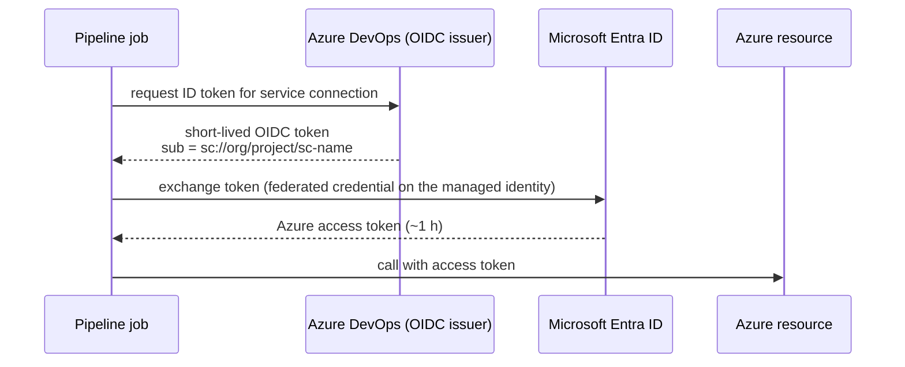

# Secretless Azure access with Workload Identity Federation

Every Azure call made by these templates - ACR push, AKS deploy, Terraform plan
and apply, Terraform state access - authenticates through an Azure Resource
Manager service connection that uses **Workload Identity Federation (WIF)**.
There is no client secret, certificate or storage account key anywhere: not in
the service connection, not in a variable group, not in Key Vault.

## How it works



The federated credential on the managed identity trusts exactly one subject,
`sc://<organisation>/<project>/<service-connection>`, so a token minted for a
different connection, project or organisation is useless.

## What the templates do with it

| Template | Task | Notes |
|---|---|---|
| `steps/acr-push.yml` | `AzureCLI@2` | `az acr login` with the federated token; ACR admin user stays disabled |
| `steps/aks-script.yml` | `AzureCLI@2` | `az aks get-credentials` + `kubelogin convert-kubeconfig -l azurecli`; works with local accounts disabled |
| `steps/terraform-init.yml` | `TerraformTask@5` | `backendAzureRmUseEntraIdForAuthentication: true` - state access via Entra ID RBAC, not storage keys |
| `jobs/terraform-plan.yml`, `jobs/terraform-apply.yml` | `TerraformTask@5` | The task configures the azurerm provider for OIDC with token refresh, so long applies do not expire mid-run |

## Setup

### Option A - Terraform (recommended)

`platform/azure-devops-governance` creates, per environment:

1. a user-assigned managed identity `id-ado-<app>-<env>`;
2. a WIF service connection `sc-<app>-<env>` pointing at that identity;
3. the federated identity credential using the issuer and subject exported by
   the service connection;
4. the RBAC role assignments you list (least privilege, per scope);
5. Required template and branch control checks on the service connection.

```bash
cd platform/azure-devops-governance
cp terraform.tfvars.example terraform.tfvars   # edit values
export AZDO_PERSONAL_ACCESS_TOKEN=...          # one-off bootstrap; prefer a pipeline with OIDC afterwards
az login
terraform init -backend-config=backend.hcl
terraform plan -out tfplan && terraform apply tfplan
```

### Option B - Portal

1. *Project settings > Service connections > New > Azure Resource Manager >
   Workload identity federation (manual)*.
2. Create a user-assigned managed identity (or app registration) and add a
   federated credential with the **issuer** and **subject identifier** shown by
   the wizard, audience `api://AzureADTokenExchange`.
3. Grant RBAC to the identity (see below) and finish the wizard.

### Converting existing secret-based connections

Existing service principal connections can be converted in place
(*Service connection > Convert*), which keeps the connection name and therefore
requires no pipeline change. Convert, run the pipeline, then delete the old
client secret from the app registration - the conversion is only complete when
the secret no longer exists.

## Least-privilege role assignments

| Identity | Scope | Role |
|---|---|---|
| Build (`sc-<app>-build`) | Container registry | `AcrPush` |
| AKS deploy (`sc-<app>-<env>`) | AKS cluster | `Azure Kubernetes Service Cluster User Role` |
| AKS deploy (`sc-<app>-<env>`) | `<cluster>/namespaces/<namespace>` | `Azure Kubernetes Service RBAC Writer` |
| Terraform plan (`sc-<app>-<env>-plan`) | Target subscription / resource groups | `Reader` |
| Terraform plan and apply | State container | `Storage Blob Data Contributor` (plan needs it for the state lease) |
| Terraform apply (`sc-<app>-<env>`) | Target resource groups | `Contributor` (+ `Role Based Access Control Administrator` with conditions only if the code assigns roles) |

Separate plan and apply identities mean a pull request - which always plans -
can never obtain write access to production.
